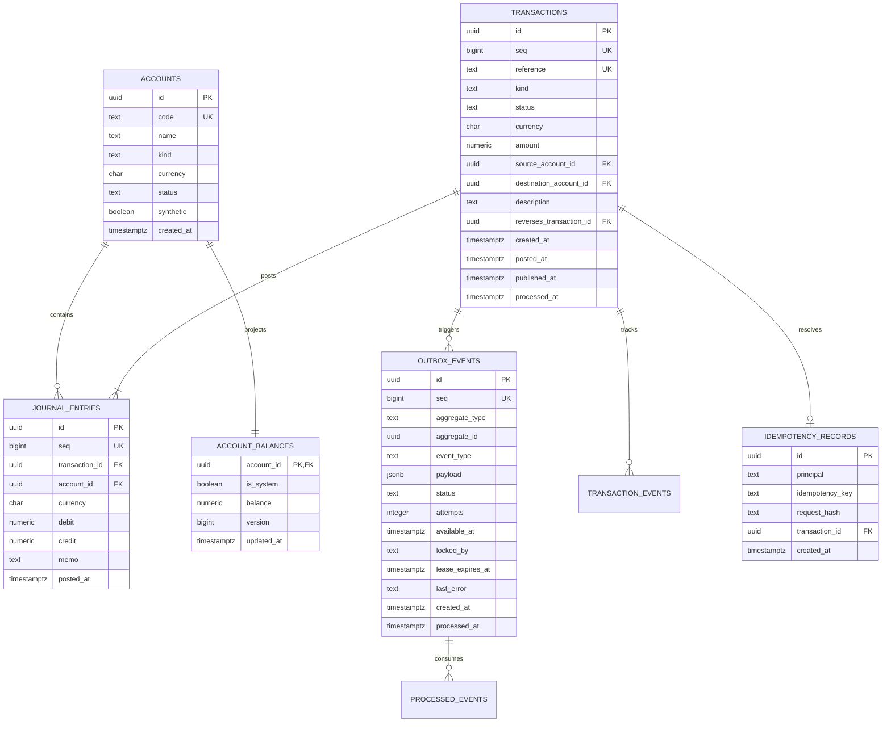

# Ledgce Data Model Specification

## 1. Schema Overview

Ledgce uses PostgreSQL 17 as its authoritative system of record. All numeric monetary fields use `NUMERIC(28, 8)` with database-enforced scale constraints:
- `USD`, `EUR`: Fixed to 2 decimal places (`amount = round(amount, 2)`).
- `IDR`: Fixed to 0 decimal places (`amount = trunc(amount)`).

---

## 2. Entity Relational Diagram

---

## 3. Database Triggers & Constraints Summary

1. `accounts_create_balance`: Automatically inserts corresponding `account_balances` row upon account creation.
2. `accounts_guard`: Prohibits deletion of accounts and mutation of immutable identity fields (`id`, `code`, `currency`, `kind`).
3. `journal_entries_before_insert`: Validates that the referenced account is in `'active'` status.
4. `journal_entries_apply_balance`: Atomically increments or decrements `account_balances.balance = balance + credit - debit` upon entry insertion.
5. `journal_entries_immutable`: Prohibits `UPDATE`, `DELETE`, or `TRUNCATE` operations on posted journal entries.
6. `transactions_guard`: Prevents modification of financial fields and validates forward-only status transitions (`posted` $\to$ `published` $\to$ `processed`).
7. `transactions_balanced` (`DEFERRED`): Asserts that $\sum \text{debits} = \sum \text{credits}$ and entry count $\ge 2$ at transaction commit.
8. `transactions_outbox_required` (`DEFERRED`): Asserts that a corresponding outbox event was created within the same database transaction.
