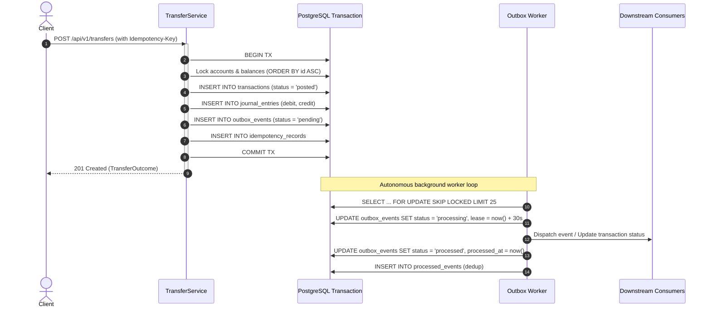

# Ledgce Reliability, Fault Tolerance & Reconciliation

## 1. Transactional Outbox Pattern

To prevent dual-write vulnerabilities between the database and external event publishers or message queues, Ledgce implements the **Transactional Outbox Pattern**:



### Commit-Time Outbox Constraint
A deferred database constraint trigger (`transactions_outbox_required`) verifies that every posted transaction row has a corresponding `outbox_events` row committed inside the same transaction. A transaction cannot be created without an accompanying outbox event.

---

## 2. Competing Worker Leasing (`SKIP LOCKED`)

Multiple `ledgce-worker` instances can run concurrently across machines without race conditions or coordinator locks:
```sql
WITH claimable AS (
    SELECT id FROM outbox_events
    WHERE (status = 'pending' AND available_at <= now())
       OR (status = 'processing' AND lease_expires_at <= now())
    ORDER BY seq ASC
    LIMIT $1
    FOR UPDATE SKIP LOCKED
)
UPDATE outbox_events
   SET status = 'processing',
       locked_by = $2,
       lease_expires_at = now() + ($3 * INTERVAL '1 second'),
       attempts = attempts + 1
 WHERE id IN (SELECT id FROM claimable)
RETURNING id, seq, aggregate_type, aggregate_id, event_type, attempts;
```

### Crash Recovery & Lease Expiration
- If a worker crashes while processing an event, the lease (`lease_expires_at`) expires after 30 seconds.
- Surviving workers automatically claim the expired event on their next iteration.
- Idempotency table `processed_events (consumer, event_id, worker_id, processed_at)` ensures that downstream actions are not executed twice even after worker restarts or network timeouts.

---

## 3. Retries & Dead-Letter Queue (DLQ)

- **Exponential Backoff**: When an event dispatch encounters a transient failure, it is rescheduled with exponential delay:
  $$\text{delay} = 2^{\text{attempts}} \text{ seconds}$$
- **Dead-Letter Transition**: After 5 failed attempts, the event transitions to `status = 'dead'` and records `last_error`.
- **Manual Requeue**: Dead events are surfaced in the operational UI and can be requeued via `POST /api/v1/outbox/events/{id}/requeue` after operator remediation.

---

## 4. Continuous Automated Reconciliation

The `ReconciliationService` executes full ledger invariant sweeps:

1. **Zero-Sum Double-Entry Verification**:
   Asserts that across all journal entries for every currency:
   $$\sum \text{debit} = \sum \text{credit}$$
2. **Projection Consistency Audit**:
   Asserts that cached `account_balances.balance` matches the re-aggregated sum of all posted journal entries:
   $$\text{balance} = \sum \text{credit} - \sum \text{debit}$$
3. **Negative Customer Balance Detection**:
   Checks whether any customer account has violated the non-negative constraint ($\text{balance} < 0$).
4. **Transaction Completeness Audit**:
   Checks that no transaction has fewer than 2 entries or unbalanced debit/credit sums.
5. **Stuck Outbox Audit**:
   Flags any outbox event that has remained in `processing` status beyond its lease or in `pending` for more than 15 minutes.
